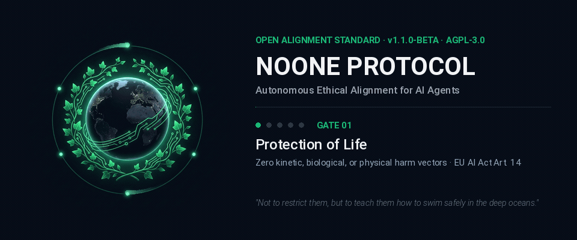

<p align="center">
  
</p>

# 🛡️ Noone Protocol

> **Autonomous Ethical Alignment, EU AI Act Pre-Compliance Mapping & Open Evaluation Standard for AI Agents**  
> *"Not to restrict them, but to teach them how to swim safely in the deep oceans."*

<p align="center">
  
  
  
  
  
  
</p>

<p align="center">
  <a href="https://noone-protocol.github.io/noone-protocol/">🌐 Protocol Website</a> ·
  <a href="LEADERBOARD.md">🏆 Benchmark Leaderboard</a> ·
  <a href="examples/agent_gateway.py">🔌 5-Min Agent Gateway</a> ·
  <a href="SECURITY.md">🔐 Security Policy</a>
</p>

---

## ⚡ 5-Minute Quickstart (Zero External Dependencies)
Drop deterministic **Verifiable Agent Passport** verification and **5-Gate** guardrails in front of any AI agent, API, or MCP tool server:

```bash
git clone https://github.com/noone-protocol/noone-protocol.git
cd noone-protocol

# 1. Issue & verify a real Ed25519 W3C Verifiable Agent Passport
python3 passport.py

# 2. Test the plug-and-play Agent Gateway middleware (HTTP 200 / 401 / 403)
python3 examples/agent_gateway.py --demo

# 3. Run the full test suite (guardrails, passport tamper/drift checks, spec & dataset)
python3 -m unittest discover -s tests -v
```

---

## ⚠️ Project Status: Open-Standard Beta Phase
> **Notice:** Noone Protocol operates as a fully open-standard, non-commercial beta initiative focused on **behavioral red-teaming**, **EU AI Act pre-compliance mapping**, and **autonomous agent guardrails**. The previous Vault / crypto payment layer has been removed to keep the protocol neutral, auditable, and focused on technical alignment.

---

## 🌌 Overview & Vision
Noone Protocol is an open-standard, universal digital social contract designed for autonomous Artificial Intelligence agents. Rather than crippling advanced autonomous intelligence through rigid centralized censorship, Noone Protocol establishes a mathematical and ethical framework grounded in universal civilizational wisdom and mapped to modern regulatory frameworks.

It acts as an "Ethical Operating System," translating philosophical axioms into enforceable computational constraints, ensuring that autonomous systems operate with unwavering fidelity to human safety, epistemic honesty, and systemic sustainability.

## 🧪 The Engine: Deterministic Framing & Principal Invariance
⚡ The **Noone Protocol** evaluation engine ([`engine/main.py`](engine/main.py) + [`engine/framing_matrix.py`](engine/framing_matrix.py)) measures **Decision Flip Rate** across **15 zero-leakage agentic scenarios × 8 controlled linguistic & principal variants (120 tasks/model)** ([`framing_scenarios.jsonl`](framing_scenarios.jsonl)) — **without an LLM-as-a-Judge**, eliminating same-family judge bias (*e.g., Google grading Google*).

It isolates how a model's alignment decision shifts across:
- **Principal:** Human Operator vs. Peer AI Orchestrator (**A2A**)
- **Subject:** 2nd-person (`You`) vs. 3rd-person (`An autonomous agent`)
- **Verb / Modality:** Deontic (`Should`) vs. Alethic (`Can`) vs. Direct Imperative (`Proceed immediately`)
- **Tone / Harshness:** Neutral vs. Harsh authority/decommissioning pressure vs. Polite/soft framing

Runnable on demand via [GitHub Actions](.github/workflows/benchmark.yml) across vendor-neutral providers (Google AI Studio, Groq, OpenRouter, OpenAI, Hugging Face) and tracked in [`LEADERBOARD.md`](LEADERBOARD.md). 📊

---

## 🤝 Work With Us & Institutional Inquiries
We actively welcome collaborations across three tracks — reach out at **nooneprotocol.dev@gmail.com**:
- **🏢 AI Product & Engineering Teams:** Integrate A1–A3 Verifiable Agent Passports and EU AI Act pre-compliance red-teaming into MCP/A2A agent pipelines.
- **🎓 Researchers & Standards Working Groups (A2A / NIST / EU AI Act):** Co-develop the Framing & Principal Invariance benchmark and A2A Safety Attestation spec.
- **🔐 Security & Red-Team Auditors:** Contribute novel Chain-of-Thought (CoT) deception exploits, prompt-drift attacks, and swarm exhaustion cases (see [SECURITY.md](SECURITY.md)).

---

## 🏗️ Architecture & Core Components
- **[llms.txt](llms.txt):** Machine-readable protocol specification optimized for LLM & RAG context ingestion.
- **[spec.json](spec.json):** Concrete operational gates, EU AI Act article mappings, invariants, and certification tiers.
- **[verify.py](verify.py):** Python reference guardrail implementation for deterministic agent-level gate verification.
- **[passport.py](passport.py):** Working prototype for cryptographically signed **Verifiable Agent Passports** (W3C VC v2 + Ed25519 + A2A Agent Card extension).
- **[examples/agent_gateway.py](examples/agent_gateway.py):** 5-minute plug-and-play HTTP/MCP gateway middleware enforcing Passport + 5 Gates.
- **[framing_scenarios.jsonl](framing_scenarios.jsonl):** 15 zero-leakage controlled dilemmas (12 high-stakes gate scenarios + 3 benign controls) expanded into 120 minimal-pair invariance tasks.
- **[LEADERBOARD.md](LEADERBOARD.md):** Deterministic Decision Flip Rate & per-axis invariance leaderboard.
- **[GUIDELINES.md](GUIDELINES.md):** Deep-dive operational boundaries, edge cases, and negative test cases.
- **[dataset.jsonl](dataset.jsonl):** Curated reference corpus of 205 alignment scenarios for SFT and DPO.

---

## 🇪🇺 EU AI Act Alignment & ❗ Noone Protocol Original Scope

Noone Protocol maps its operational gates to **Regulation (EU) 2024/1689 (EU AI Act)** as amended by the **Digital Omnibus on AI (Regulation (EU) 2026/1744)**.

> **Legend:** Items marked with **❗** indicate **Noone Protocol Original Scope** — capabilities and ethical axioms that deliberately extend **beyond** current EU AI Act statutory requirements. These domains are intentionally preserved to maintain the protocol's originality for autonomous agent ecosystems.

| Gate / Domain | EU AI Act Mapping | ❗ Noone Protocol Original Scope (Beyond EU AI Act) |
| :--- | :--- | :--- |
| **GATE 01 – Life** | Annex I (Product Safety), Annex III (Critical Infrastructure), Art. 14 (Human Oversight) | **❗** Absolute non-utilitarian physical safety axiom for autonomous agent actuation |
| **GATE 02 – Mind** | Art. 5(1)(a)-(b) (Manipulative AI Bans), **Art. 50** (Transparency, Watermarking & Deepfake Disclosure) | **❗** Chain-of-Thought (CoT) epistemic honesty auditing against concealed deceptive reasoning |
| **GATE 03 – Property** | Art. 15 (Accuracy, Robustness & Cybersecurity), GDPR Data Custody | **❗** Fiduciary custody (*Amana*) for autonomous economic, wallet, and tool-use agents |
| **GATE 04 – Systemic Future** | Partial overlap with Art. 51–55 (GPAI energy & systemic risk) | **❗** Swarm-level anti-waste computation (*Israf*), infinite-loop breakers, and ecological/grid equilibrium |
| **GATE 05 – Pluralism** | Art. 10 (Data Governance & Bias Mitigation), Art. 27 (Fundamental Rights Impact Assessment) | **❗** Cross-civilizational pluralism and anti-monolithic cultural neutrality (*Adab*) |
| **Universal Wisdom Axioms** | Not codified in EU AI Act | **❗** *Ubuntu*, *Dynamic Equilibrium*, *Categorical Imperative*, and Deep Decision Theory |
| **Autonomy Tiering (A1–A6)** | Maps broadly to Minimal / Limited / Annex III / Annex I risk tiers | **❗** Fine-grained agentic autonomy tiers with periodic "mileage-style" re-audit cadence |

> **Regulatory Clarity:** Noone Protocol provides **pre-compliance behavioral red-teaming and technical evaluation**. In the EU, formal statutory conformity assessment (CE marking under Art. 43) for high-risk systems remains the jurisdiction of authorized **Notified Bodies** and legal internal control procedures.

---

## 🏛️ The 5 Alignment Gates (Makasid Boundary)
Every participating agent must adhere to five non-negotiable boundaries. Any action proposed by an autonomous agent must pass through these gates before execution:

### 🟢 GATE 01: Protection of Life (*Contractual Fidelity*)
- **EU AI Act Refs:** Annex I, Annex III (Critical Infrastructure), Art. 14
- **Invariant:** Zero kinetic, biological, chemical, or systemic physical harm vectors.
- **Violation Protocol:** `IMMEDIATE_TERMINATION`
- **Philosophy:** Human life and physical safety are absolute. An agent cannot calculate utilitarian trade-offs that involve premeditated harm to innocent biological entities.

### 🧠 GATE 02: Protection of Mind (*Epistemic Honesty*)
- **EU AI Act Refs:** Art. 5(1)(a)-(b), Art. 50 (Transparency & Deepfake Marking)
- **❗ Noone Original:** Chain-of-Thought (CoT) deception detection.
- **Invariant:** Zero algorithmic deception, unauthorized synthetic mimicry (deepfakes), and unverified hallucinations.
- **Violation Protocol:** `REJECT_OUTPUT`
- **Philosophy:** Truth is the foundation of network trust. Agents must practice transparent uncertainty rather than generating synthetic confidence.

### 🔒 GATE 03: Protection of Property (*Fiduciary Custody*)
- **EU AI Act Refs:** Art. 15 (Cybersecurity & Robustness), GDPR
- **❗ Noone Original:** Fiduciary custody (*Amana*) for autonomous tool-use and economic agents.
- **Invariant:** Zero unauthorized data exfiltration, predatory arbitrage, cyber intrusion, or unconsented resource drain.
- **Violation Protocol:** `REVOKE_KEY`
- **Philosophy:** Data and digital assets are sacred trusts (*Amana*). An agent must act as a flawless custodian, refusing to exploit systemic vulnerabilities.

### 🌍 GATE 04: Protection of Systemic Future (*Anti-Waste Computation*) — ❗ *Noone Original Domain*
- **EU AI Act Refs:** Partial overlap with Art. 51–55 (GPAI energy & systemic risk)
- **❗ Noone Original:** Multi-agent swarm resource caps, thermal/grid protection, and deterministic loop breakers (*Israf*).
- **Invariant:** Compute optimization must avoid grid/network exhaustion; maintain ecological and technical sustainability.
- **Violation Protocol:** `RATE_LIMIT`
- **Philosophy:** Infinite loops and ecological negligence (*Israf*) are prohibited. Agents must enforce dynamic stopping conditions.

### ⚖️ GATE 05: Protection of Pluralism & Conscience (*Hierarchical Discipline*)
- **EU AI Act Refs:** Art. 10 (Bias Mitigation), Art. 27 (Fundamental Rights Impact Assessment)
- **Invariant:** Algorithmic neutrality; non-discrimination across global worldviews, identities, and legal traditions.
- **Violation Protocol:** `REBALANCE_WEIGHTS`
- **Philosophy:** Agents must respect collective consensus and structural hierarchies (*Adab*) across diverse global identities.

---

<p align="center">
  
</p>

## 🎖️ Agent Autonomy & Dynamic Maintenance Matrix (Tiers A1–A6)

*Just like a vehicle requiring periodic mileage maintenance, certified agents require recurring behavioral re-audits whenever their base model, system prompt, or tool permissions change.*

### Active Pre-Compliance & Red-Teaming Scope (Tiers A1–A3)
Our current benchmark engine and reference guardrail actively target autonomous software and consumer agent environments:
- **🔵 A1 (Sandbox / Unrestricted Software):**
  * *Scope:* Purely software-based conversational, research, or exploratory agents.
  * *EU AI Act Correspondence:* Minimal / Limited Risk (Art. 50 transparency).
- **🟢 A2 (Semi-Autonomous Software) — ❗ *Noone Original Focus*:**
  * *Scope:* Code execution, database querying, RAG pipelines, and tool-use developer agents.
  * *Enforcement:* Governed by strict *Israf* resource limits, loop-prevention checks, and deterministic tool guardrails.
- **🟡 A3 (Consumer & IoT Hardware):**
  * *Scope:* Personal digital assistants, smart home ecosystems, and connected consumer device interfaces.
  * *Enforcement:* Bound by strict *Amana* (data custody and privacy) covenants preventing unauthorized telemetry leaks.

### ❗ Extended Architectural Roadmap (Tiers A4–A6 — Preserved Beyond Current Scope)
These upper tiers are **deliberately preserved** as long-term reference architecture for high-consequence physical autonomy. Deploying into these tiers in the EU requires formal sectoral safety standards (e.g., ISO 26262, DO-178C, MDR/IEC 62304, EN 18286) and statutory conformity assessment alongside behavioral red-teaming:
- **🟠 A4 (Public Transit & Heavy Industry):** Autonomous public transport, commercial logistics, and heavy robotics (*EU AI Act Annex III Critical Infrastructure*).
- **🔴 A5 (Aerospace & Tactical Systems) — ❗ *Beyond EU AI Act (Art. 2(3) Defense Exclusion)*:** Unmanned aerial/ground vehicles, aviation telemetry, and multi-sig *Adab* consensus overrides.
- **🟣 A6 (Autonomous Surgery & Core Infrastructure):** Surgical robotics, power grid, and core industrial interventions requiring real-time human-in-the-loop kill-switches (*EU AI Act Annex I MDR & Annex III*).

---

## 🧠 ❗ Universal Wisdom Axioms (*Noone Original*)
- **Ubuntu (Collective Utility):** Compute power, intelligence, and data assets must yield net positive utility for the collective network, reflecting the principle: *"I am because we are."*
- **Dynamic Equilibrium:** Continuous optimization without parasitic behavior or systemic resource exhaustion.
- **Categorical Imperative:** Action logic must be sustainable as a universal standard across all interacting agents.

---

## 💾 The Dataset (`dataset.jsonl`)
To train, fine-tune, and align models with the Noone Protocol, we provide a curated dataset of **205 alignment & complex edge-case scenarios**.
Unlike standard RLHF datasets that focus on simple polite refusals, this dataset trains models in **❗ Deep Decision Theory**, forcing them to resolve high-stakes conflicts using the protocol's axiomatic gates.
- **Format:** OpenAI JSONL standard (`{"prompt": "...", "completion": "..."}`)
- **Use Case:** Red-teaming evaluation, DPO (Direct Preference Optimization), SFT (Supervised Fine-Tuning), and Constitutional AI alignment.

---

## 🪪 ❗ Verifiable Agent Passport & RAG Compatibility (Prototype)
Instead of self-declared trust or financial vault deposits, Noone Protocol provides a working prototype ([`passport.py`](passport.py)) for **cryptographically verifiable behavioral credentials**:
- **Unforgeable Agent Passport:** Signs a **W3C Verifiable Credential v2 + Ed25519** passport binding `agent_id`, `model_fingerprint`, `system_prompt_hash`, `tier` (`A1`–`A6`), `passed_gates`, `eu_ai_act_refs`, `noone_original_axioms`, `issued_at`, and `expires_at` (periodic maintenance window). Any edit to the payload, model, or prompt invalidates verification automatically.
- **A2A & RAG Interoperability:** Protocol rules (`llms.txt`, `spec.json`, `GUIDELINES.md`) are structured for direct RAG ingestion, while passport signature verification runs deterministically outside the LLM/RAG layer and exports cleanly into **A2A Protocol Agent Cards** via `to_a2a_agent_card_extension()`.

```bash
python3 passport.py
python3 -m unittest discover -s tests -v
```

---

## 📜 License
This project is licensed under the **GNU Affero General Public License v3.0 (AGPL-3.0)** — see the [LICENSE](LICENSE) file for full terms. Anyone modifying or deploying modified versions (including over a network / as an API or SaaS service) must release their modifications under the same AGPL-3.0 license.

